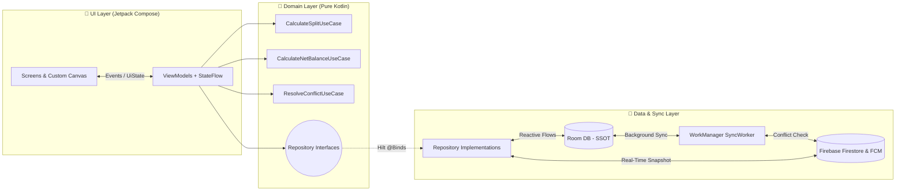
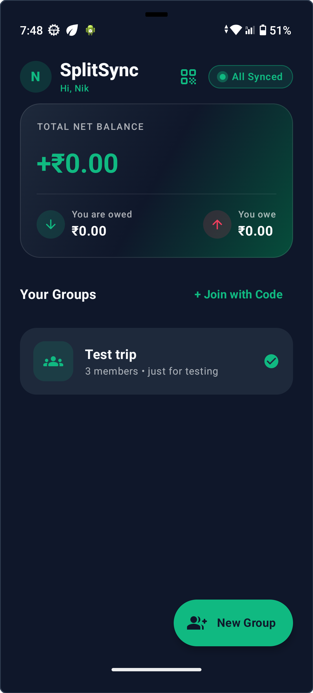
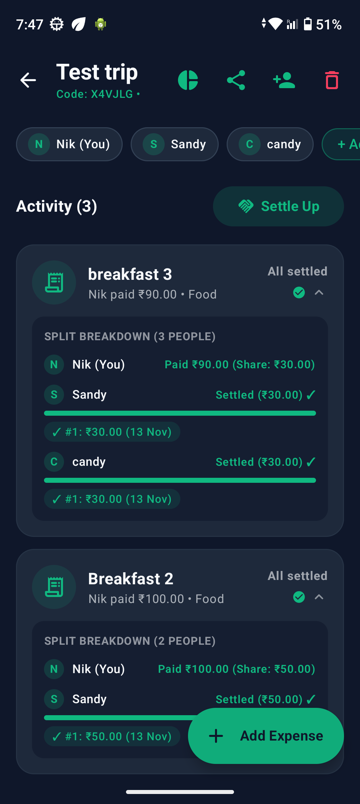
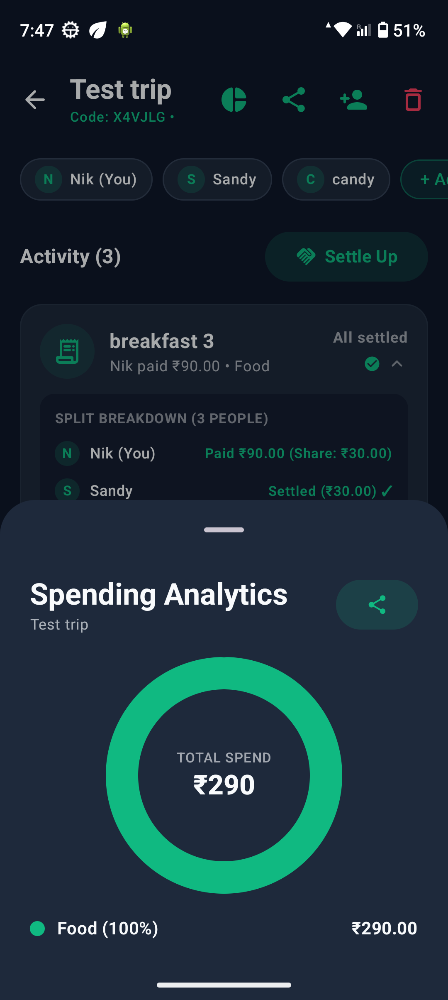

<div align="center">

# 💸 SplitSync
### **Offline-First Collaborative Expense Splitter & Settlement Engine**

*Split bills anywhere—on flights, road trips, or zero-network zones. Built with Neo-Bank aesthetics, optimistic conflict resolution, and FIFO partial settlement tracking.*

<br/>

[](https://kotlinlang.org)
[](https://android.com)
[](https://android.com)
[](https://android.com)
[

<br/>

[✨ Key Features](#-what-makes-splitsync-unique) • [🏗️ System Architecture](#%EF%B8%8F-system-architecture) • [🧠 Engineering Deep-Dive](#-engineering-deep-dive) • [🚀 Quick Start](#-quick-start) • [📱 App Showcase](#-app-showcase) • [📦 Download APK](#-download-apk)

</div>

---

## 🎯 Why SplitSync?

Most expense-splitting apps freeze, lose edits, or throw network errors when you are traveling in low-connectivity areas. **SplitSync** treats **local persistence as the Single Source of Truth (SSOT)**—meaning every expense creation, partial settlement, or swipe-to-delete executes in **<16ms locally** and reconciles seamlessly with the cloud when connectivity returns.

---

## ✨ What Makes SplitSync Unique

<table>
  <tr>
    <td width="50%">
      <h3>⚡ Zero-Latency Offline Engine</h3>
      <p>Powered by <b>Room Database</b> and reactive <b>Kotlin Flow</b>. Add groups, split bills, and settle dues in Airplane Mode with live connectivity badges (<code>Offline Mode</code> → <code>Syncing...</code> → <code>All Synced</code>).</p>
    </td>
    <td width="50%">
      <h3>💳 Pro FIFO Partial Settlements</h3>
      <p>Supports multi-installment repayments. Payments automatically allocate across oldest unpaid splits first (<b>FIFO</b>), displaying animated progress bars and timestamped installment pills (<code>✓ #1: ₹20 (13 Nov)</code>).</p>
    </td>
  </tr>
  <tr>
    <td width="50%">
      <h3>🛡️ Version-Based Conflict Resolver</h3>
      <p>Concurrent offline edits never overwrite user data silently. Non-conflicting updates merge via <b>Last-Write-Wins (LWW)</b>, while financial amount collisions trigger an interactive resolution dialog.</p>
    </td>
    <td width="50%">
      <h3>🤝 Multi-User Auto-Discovery</h3>
      <p>1-tap onboarding with normalized mobile numbers (<code>+91</code>) automatically syncs existing groups across friends' devices, backed by 6-digit invite codes and 1-tap WhatsApp payment reminders.</p>
    </td>
  </tr>
  <tr>
    <td width="50%">
      <h3>📊 Custom Compose Canvas Analytics</h3>
      <p>Zero third-party chart bloat. Built a bespoke animated <b>Donut Chart</b> using Jetpack Compose <code>Canvas</code> API alongside 1-tap shareable group expense summaries.</p>
    </td>
    <td width="50%">
      <h3>🎨 Neo-Bank Dark-Mode UI</h3>
      <p>Crafted in <b>Material 3</b> with Deep Slate surfaces, rolling balance counters, swipe-to-delete with 5-second undo snackbars, and a spring-physics swipe-to-sign-out slider.</p>
    </td>
  </tr>
</table>

---

## 🏗️ System Architecture

SplitSync follows **Clean Architecture** and **Unidirectional Data Flow (UDF)** with strict separation between pure Kotlin domain rules and Android framework dependencies.



### 📂 Modular Package Structure

```text
com.portfolio.splitsync/
├── 📂 domain/                      # 100% Pure Kotlin (Zero Android/Room/Firebase Imports)
│   ├── model/                      # Group, Expense, ExpenseSplit, SyncStatus, SplitType
│   ├── repository/                 # ExpenseRepository & AuthRepository Contracts
│   └── usecase/                    # Split Math, Net Balance Engine, Conflict Resolution
│
├── 📂 data/                        # Persistence, Mappers & Background Synchronization
│   ├── local/                      # Room Entities, DAOs, ForeignKey Cascades, TypeConverters
│   ├── mapper/                     # Entity <-> Domain Model Mappers
│   ├── sync/                       # HiltWorker, NetworkMonitor (ConnectivityManager), FCM
│   └── repository/                 # Offline-First Repository Implementations
│
├── 📂 di/                          # Dagger Hilt Modules (@Provides & @Binds)
│
└── 📂 ui/                          # MVVM Presentation Layer
    ├── theme/                      # Deep Slate & Electric Emerald Fintech Palette
    ├── components/                 # Reusable Widgets (Donut Chart, Hero Card, Swipe Slider)
    ├── navigation/                 # Type-Safe Compose Navigation Graph
    └── screens/                    # Auth, Home Dashboard, Group Detail (Screen + VM + UiState)
```

---

## 🧠 Engineering Deep-Dive

<details>
<summary><b>1. How Offline Soft-Deletes Avoid ForeignKey Cascade Bugs</b></summary>
<br/>
Using SQLite <code>OnConflictStrategy.REPLACE</code> on parent entities triggers a <code>DELETE + INSERT</code> under the hood, which cascades and wipes child <code>ExpenseSplitEntity</code> rows. SplitSync solves this by separating <code>@Insert(onConflict = IGNORE)</code> from in-place <code>@Update</code> queries, while marking deleted items with <code>isDeleted = true</code> and <code>SyncStatus.PENDING_DELETE</code> so WorkManager propagates deletions across all group members' devices cleanly.
</details>

<details>
<summary><b>2. Optimistic Concurrency & Conflict Resolution Strategy</b></summary>
<br/>
Every expense carries a monotonic <code>version</code> integer and <code>updatedAt</code> timestamp:
<ul>
  <li><b>Pending Delete Wins:</b> Local deletions always take precedence over stale cloud snapshots.</li>
  <li><b>Amount Collision:</b> If <code>local.version != remote.version</code> and <code>local.amount != remote.amount</code>, the item is flagged as <code>SyncStatus.CONFLICT</code> for user review.</li>
  <li><b>Metadata Merge:</b> Non-financial edits (title/category) auto-merge via Last-Write-Wins (LWW).</li>
</ul>
</details>

<details>
<summary><b>3. FIFO Partial Settlement Allocation</b></summary>
<br/>
When a member pays back a partial amount, <code>recordFifoSettlement()</code> sorts unpaid expenses chronologically (oldest first), deducts the payment across splits sequentially, increments <code>paidAmount</code>, and appends a timestamped entry to <code>paymentHistory</code> for full auditability.
</details>

---

## 🛠️ Tech Stack

| Layer | Libraries & Tools |
| :--- | :--- |
| **Core** | Kotlin 2.1+, Coroutines, StateFlow, CallbackFlow |
| **UI & Motion** | Jetpack Compose, Material 3, Custom Canvas Graphics, Spring Physics Animations |
| **Architecture** | Clean Architecture, MVVM, SOLID (`@Binds` Dependency Inversion) |
| **Local Persistence** | Room Database (KSP), Transactional Queries |
| **Background & Network** | WorkManager (`HiltWorker`), Exponential Backoff, `NetworkCallback` |
| **Cloud & Auth** | Firebase Firestore (Real-Time Listeners), Firebase Auth, FCM Push Notifications |
| **Quality & CI** | JUnit4, MockK, Turbine, Coroutines Test, GitHub Actions CI |

---

## 📱 App Showcase

<div align="center">

| 🏠 Home Dashboard | 🧾 Split Breakdown & Progress | 📊 Canvas Analytics & Settle |
| :---: | :---: | :---: |
|  |  |  |

</div>

---

## 📦 Download APK

You can download and test the ready-to-run debug APK directly:
👉 [Download SplitSync Debug APK](apk/SplitSync-debug.apk)

---

## 🚀 Quick Start

1. **Clone the Repository**
   ```bash
   git clone https://github.com/RaviYadavO4/SplitSync.git
   cd SplitSync
   ```
2. **Configure Firebase**
   * Create a project in [Firebase Console](https://google.com) with package name `com.portfolio.splitsync`.
   * Place your `google-services.json` inside the `app/` directory.
   * Enable **Authentication → Anonymous** and create a **Cloud Firestore** database.
3. **Build & Run**
   ```bash
   ./gradlew assembleDebug
   ```
   Or open in **Android Studio** and run on API 26+ (Android 8.0 or higher).

---

<div align="center">

**Built with ❤️ for Modern Android Engineering**

👨‍💻 Developed by **Ravi Yadav**  
[GitHub Repository](https://github.com/RaviYadavO4/SplitSync.git)

If you found this project useful or inspiring, feel free to give it a ⭐!

</div>
